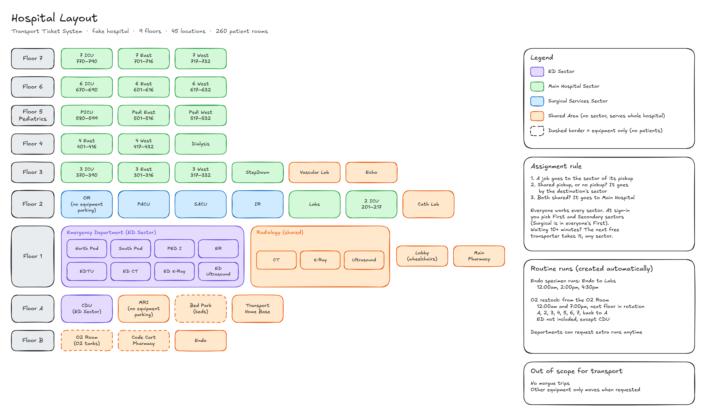

# Hospital Transport Ticket System

A dispatch system for hospital transport. Any department can request a move for a **patient**, a piece of **equipment** (beds, stretchers, wheelchairs, O2 tanks, code carts), or a **specimen**. The system assigns each call to a transporter by sector, transporters work their calls from a phone app with wristband scanning, and a dispatcher keeps an eye on everything live.

> Solo project by Rex. All patient data is fake.

## Status
**In progress.** Week 1 (planning and design) is done. Next up: the Spring Boot backend.

## Why I'm building this
I work in hospital patient transport, so this is built around how the job actually runs:
- Transporters sign in to sectors and get calls **assigned** to them. Nobody browses or claims calls.
- STAT calls go first, and calls that sit too long get picked up by whoever frees up next.
- A dispatcher watches the whole board and can step in at any time.

## Planned features
**Core (must ship)**
- Requests for patients, equipment, and specimens from any department, with trip purpose, clinical needs, and isolation precautions
- Automatic assignment by sector: each transporter has **First** and **Secondary** sectors, STAT first, whoever has been free the longest next, and a 10-minute wait limit so no call gets stuck
- Acknowledge and escalation timers, plus delay / postpone / cancel with reasons
- Dispatcher board with live updates
- Transporter mobile app with QR scanning for patient wristbands and equipment tags, and push notifications for new and STAT calls
- Messaging on each call between the transporter, dispatcher, and requester
- Logins through Keycloak with five roles: staff, transporter, dispatcher, manager, admin
- Live deployment on Azure with HTTPS and CI/CD

**After that:** routine runs (O2 restock, specimen runs), a staging environment, backups, and monitoring.
**Stretch:** smart dispatch with a hospital map and a simulation to measure it, Active Directory sign-in, and manager reports.

## Tech stack
| Part | Tech |
|---|---|
| Backend | Java 25, Spring Boot |
| Database | PostgreSQL 17 (Docker) |
| Web app | React + TypeScript (Vite) |
| Mobile app | React Native + Expo |
| Logins | Keycloak (Active Directory later) |
| Hosting | Azure VM, Caddy, GitHub Actions |

## Design docs


| Doc | What's in it |
|---|---|
| [hospital.md](docs/hospital.md) | The fake hospital: floors, sectors, rooms, equipment spots, routine runs, and who gets each call |
| [walkthroughs.md](docs/walkthroughs.md) | Step-by-step walkthroughs of real transport jobs |
| [roles.md](docs/roles.md) | The five roles and what each one can do |
| [lists.md](docs/lists.md) | Priorities, statuses, transport modes, equipment, clinical requirements, isolation, reasons |
| [api.md](docs/api.md) | Every API route, plus the status rules |
| [database.md](docs/database.md) | The database diagram (17 tables) |

## Running it locally
Right now this starts the database. The app comes next.

1. Install [Docker Desktop](https://www.docker.com/products/docker-desktop/) and open it.
2. Copy the example settings, then open `.env` and pick a password:
   ```bash
   cp .env.example .env
   ```
3. Start PostgreSQL:
   ```bash
   docker compose up -d
   ```
4. Check that it's running with `docker ps`. The database is on `localhost:5432`, using the user, password, and database name from your `.env`.

The tables get created in week 2, when the backend's database migrations (Flyway) come in.

## Project structure
```
docs/               design docs and diagrams
db/                 empty for now (tables come in week 2)
docker-compose.yml  PostgreSQL for local development
.env.example        settings template (copy it to .env)
```

## Roadmap
| Weeks | Goal |
|---|---|
| 1 | Planning and design docs (done) |
| 2-5 | Backend: requests, assignment engine, shifts and timers, Keycloak logins |
| 6-9 | Web app, dispatcher board, and the transporter mobile app |
| 10-11 | Deploy to Azure, polish, demo video |
| 12-13 | Routine runs, messaging extras, staging, backups, monitoring |
| 14-16 | Stretch: smart dispatch + simulation, Active Directory, reports |

## How it's built
Every change starts as a GitHub issue, gets its own branch, and goes in through a pull request with a self-review checklist. `main` is protected, so nothing goes in without a PR.

## Author
Rex ([@rexRex1012](https://github.com/rexRex1012))
