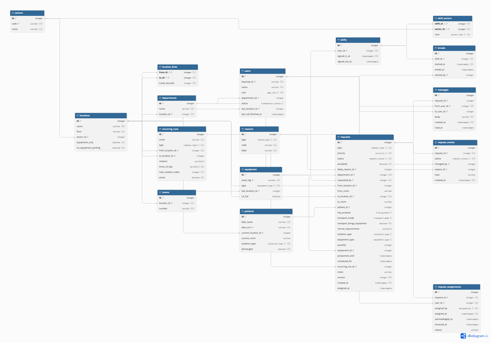

# Database Diagram

How the transport system's data is stored: 17 tables in PostgreSQL. Made with dbdiagram.io.

## Main groups
- **Hospital:** sectors, locations, departments, rooms
- **People:** users, shifts, shift_sectors, breaks
- **Things being moved:** patients, equipment
- **The work:** requests, request_assignments, request_events, messages
- **Setup:** reasons, recurring_runs, location_links (for smart dispatch later)

To edit it, paste `database.dbml` into dbdiagram.io, change it, and export a new PNG.
