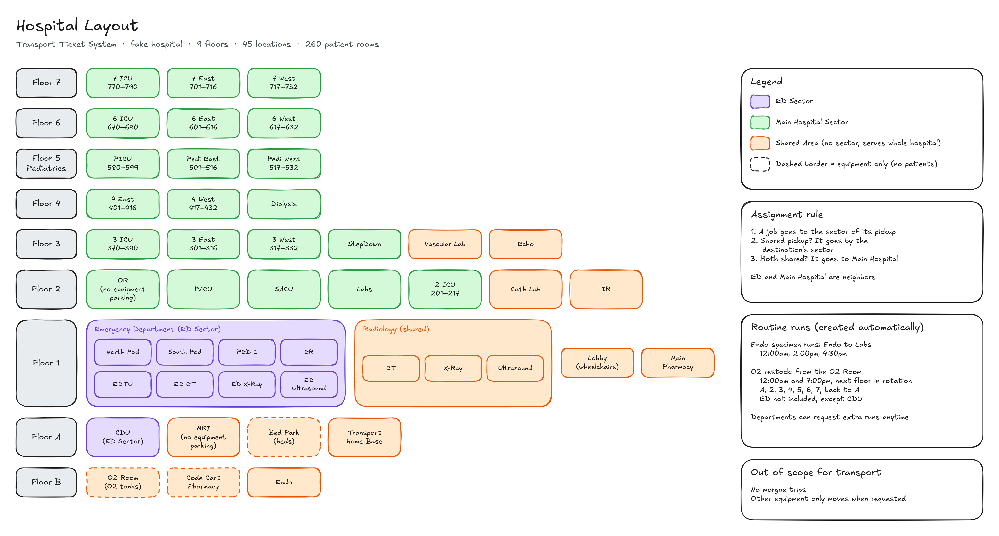

# Hospital Layout

Editable version: `hospital.excalidraw` (open it at excalidraw.com)

## Sectors
- **ED Sector**: North Pod, South Pod, PED I, ER, EDTU, ED CT / X-Ray / Ultrasound, CDU (Floor A)
- **Main Hospital Sector**: all patient units on Floors 2–7 (OR, PACU, SACU, Labs, 2 ICU, ICUs, East, West, StepDown, Dialysis, PICU, Pedi East, Pedi West)
- **Shared Areas** (no sector, serve the whole hospital): Radiology, MRI, Endo, Cath Lab, IR, Echo, Vascular Lab, Lobby, Main Pharmacy, Bed Park, O2 Room, Code Cart Pharmacy, Transport Home Base
- ED and Main Hospital are neighboring sectors

### Assignment rule
1. A job goes to the sector of its **pickup** location
2. If the pickup is a shared area, it goes by the **destination's** sector
3. If both are shared areas, it goes to **Main Hospital**

## Floors
- **Floor B:** O2 Room (return used tanks, pick up full ones), Code Cart Pharmacy, Endo
- **Floor A:** CDU (ED Sector), MRI, Bed Park, Transport Home Base
- **Floor 1:** Emergency Department, Radiology (CT, X-Ray, Ultrasound), Lobby, Main Pharmacy
- **Floor 2:** OR, PACU, SACU, Labs, 2 ICU, Cath Lab, IR
- **Floor 3:** ICU, East, West, StepDown, Vascular Lab, Echo
- **Floor 4:** East, West, Dialysis (no ICU)
- **Floor 5 (Pediatrics):** PICU, Pedi East, Pedi West
- **Floor 6:** ICU, East, West
- **Floor 7:** ICU, East, West

## Room Numbers
Rooms are numbered floor + room (e.g. 612 = Floor 6, room 12).

- **East (Floors 3–7):** rooms 1–16 (e.g. 601–616)
- **West (Floors 3–7):** rooms 17–32 (e.g. 617–632)
- **ICU (Floors 3, 6, 7):** rooms 70–90 (e.g. 670–690)
- **PICU (Floor 5):** rooms 80–99 (580–599)
- **2 ICU (Floor 2):** rooms 1–17 (201–217)
- Floor 5 East/West are Pedi East/Pedi West, and Floor 4 has no ICU
- 260 patient rooms total

## Equipment
- **Beds:** Bed Park (Floor A)
- **Wheelchairs:** Lobby (Floor 1)
- **O2 tanks:** O2 Room (Floor B), full or empty
- **Code carts:** Code Cart Pharmacy (Floor B)
- **Stretchers and other equipment:** parked around the floors, anywhere except hazardous areas. Location comes from the last scan, and requests can ask for the nearest available one
- **Dirty equipment:** marked dirty where it is. It only gets moved if someone puts in a request for it

## Location Flags
- **Equipment only** (no patients): O2 Room, Code Cart Pharmacy, Bed Park
- **No equipment parking** (hazardous): OR, MRI

## Routine Runs
Created automatically by the system on a schedule. Departments can still request an extra run anytime.

- **Endo specimen runs:** Endo (Floor B) to Labs (Floor 2) at 12:00am, 2:00pm, and 4:30pm every day
- **O2 restock:** from the O2 Room (Floor B) at 12:00am and 7:00pm. Each run goes to the next floor in the rotation (Floor A, 2, 3, 4, 5, 6, 7, then back to A), so 2 different floors get restocked every day. The ED is not in the rotation, except CDU (Floor A), which is

## Time Zone
All times in this doc (routine runs, shifts) are hospital time, **America/New_York**, including daylight saving. The system stores times in UTC but schedules and reports by hospital time.

## Patients
Patients are fake and come from a seed script, spread across the units and the ED, each with a current location and room. An admin can add more. A real hospital would get these from its EHR (like Epic).

## Out of Scope for Transport
- **Morgue:** transport doesn't handle morgue trips
- **Other equipment:** only moved when a request says where it needs to go. No routine pickups or returns besides the runs above
